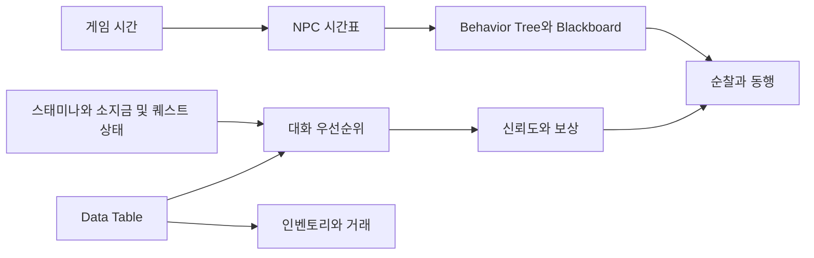
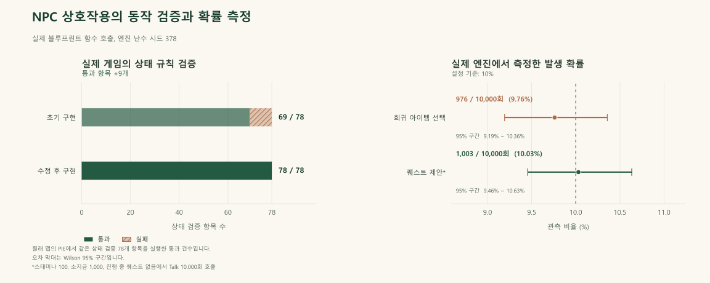

# 상황 인식형 NPC 상호작용 시스템

[English](README.md) | [한국어](README.ko.md)

**NPC는 플레이어가 직접 조작하지 않고 게임이 행동을 결정하는 캐릭터**입니다.
플레이어가 캐릭터에게 다가가 대화하거나 거래하고, 퀘스트를 수행하거나
동행을 요청할 수 있습니다. 게임 시간과 스태미나, 소지금과 퀘스트 진행 상태,
해당 캐릭터와의 관계에 따라 대사와 가능한 행동, 이동이 달라집니다.

다섯 NPC의 일과, 상황별 대화, 퀘스트, 거래, 신뢰도와 동행 행동을 하나의 게임플레이로 연결한 Unreal Engine 개인 프로젝트입니다.

**엔진:** Unreal Engine 5.4.4  
**최초 개발 기간:** 2025년 9월부터 2026년 6월  
**구현 기술:** Blueprint, Behavior Tree, Blackboard, Data Table, C++  
**현재 소스 배포 버전:** `1`

## 프로젝트 개요

NPC의 일과와 플레이어와의 관계, 현재 게임 상태가 서로 영향을 주는 상호작용을 구현했습니다. 공통 게임 시간이 NPC의 시간표를 제어하고, 대화 우선순위가 상황에 맞는 응답을 선택하며, 신뢰도가 대화와 퀘스트를 거래 및 동행 행동으로 연결합니다.

실제 게임은 직접 작성한 규칙과 Unreal의 AI 행동으로 동작합니다. 개발 과정에서 Qwen 적용 가능성을 별도로 실험했으나 게임 제약 조건을 일관되게 지키지 못해 본 게임에는 통합하지 않았습니다. 이후 보완에서는 다섯 NPC의 기본 구조를 유지하면서 일부 상호작용 오류를 수정하고, 소스 복원 도구와 실제 엔진 검증을 추가했습니다. 보완 및 검증 기록은 최초 개발 기간과 구분합니다.


게임 화면은 원래 영어 UI를 그대로 캡처했으며, 대화문과 버튼 표시는 번역하거나 편집하지 않았습니다.

### Unreal 구성 요소의 역할

**Blueprint는 노드를 연결해 게임 규칙을 구현하는 Unreal Engine의 시각적
프로그래밍 도구**입니다. **Behavior Tree는 순찰이나 동행처럼 다음에 수행할
행동을 선택하는 구조**이며, **Blackboard**에 저장한 상태를 참고합니다.
**Data Table**은 직접 작성한 NPC와 아이템, 퀘스트 정보를 담고, **UMG**는
대화창과 인벤토리, 상점 같은 화면을 구성합니다.

**Actor**는 게임 공간에 배치된 객체입니다. 겹침 검사는 감지 영역 안에 들어온
주변 객체를 찾는 과정이며, 플레이어 Actor의 전방 벡터는 캐릭터가 바라보는
방향을 뜻합니다. 대상 선택은 이 주변 NPC 목록과 방향을 사용해 상호작용할
캐릭터를 정합니다.

## 주요 기능

| 시스템 | 구현 방식 | 플레이 결과 |
| --- | --- | --- |
| NPC 일과 | 하루 1,440분 게임 시간과 NPC별 시간표, Behavior Tree 및 Blackboard 상태를 연결합니다. | NPC가 정해진 시간에 등장하고 순찰하며 퇴장합니다. |
| 상황별 대화 | 진행 중인 퀘스트를 먼저 처리합니다. 활성 퀘스트가 없으면 스태미나 부족과 소지금 부족을 확인한 뒤 초기 퀘스트 제안 및 일반 대화로 이어집니다. | 퀘스트 진행을 유지하면서 플레이어의 상태를 대화에 반영합니다. |
| 신뢰도와 동행 | NPC별 신뢰도와 상호작용 상태에 따라 관계에 따른 행동을 결정합니다. | 조건을 충족한 NPC가 플레이어를 따라오고 일반 행동으로 복귀합니다. |
| 퀘스트, 인벤토리와 거래 | Data Table로 아이템, NPC, 퀘스트를 정의하고 UMG에서 거래와 아이템 사용을 처리합니다. | 대화, 수집, 보상, 소지금과 스태미나가 하나의 플레이 흐름으로 연결됩니다. |
| 상호작용 대상 선택 | 실제로 겹치는 NPC 중 플레이어 Actor의 전방 벡터를 기준으로 방향 점수가 가장 높은 대상을 선택합니다. | 캐릭터가 바라보는 방향에 따라 상호작용 대상을 정합니다. |
| 플레이어 시스템 | 달리기, 스태미나, 시점 전환, 아이템 획득, 인벤토리와 상점을 구현했습니다. | 실제 플레이 환경에서 NPC 기능을 확인할 수 있습니다. |



[구조와 보완 내용](docs/architecture.ko.md)에서 초기 구현, 대화 우선순위 수정과 상호작용 도중 퇴장을 방지하는 조건을 설명합니다.

[Blueprint 구현 검토 안내](docs/blueprint-inspection.ko.md)에서 실제 에셋에 대응하는 노드, 핀, Data Table과 행동 트리 작업 설정을 확인할 수 있습니다.

## 검증 결과

**Play in Editor(PIE)는 Unreal 에디터 안에서 게임을 실행하는 기능**입니다.
상태 검증은 입력 상태와 기대 동작을 정한 뒤 둘이 맞는지 확인합니다. 예를
들어 스태미나와 퀘스트 상태를 설정한 뒤 해당 상태에 맞는 대화가 나오는지
검사합니다. 검증용 준비 조건인 fixture를 동일하게 구성하면 같은 검사를
반복할 수 있습니다. 통과 수는 이 기대 항목을 충족한 수이며 모델의 예측
정확도를 뜻하지 않습니다.

아래 결과는 실제 Play in Editor의 Actor와 게임의 Blueprint 함수를 실행해 확인했습니다. 예상 결과와 검증 조건은 테스트 소스 및 JSON에 명시했습니다.



| 측정 항목 | 확인한 결과 | 검증 범위 |
| --- | --- | --- |
| 동일한 상태 검증 항목 | **초기 69/78개, 수정 후 78/78개 통과** | 같은 시나리오에서 실패하던 기대 조건 9개를 수정했습니다. |
| 상호작용 대상 선택 | **사전에 정의한 30/30개 조건 통과** | 초기 NPC 3명의 위치와 겹침 상태를 고정하고 플레이어 Actor의 회전만 변경했습니다. |
| 조건을 충족한 퀘스트 제안 | **10,000회 중 1,003회, 10.03%** | 조건을 매번 초기화한 실제 대화 함수 호출입니다. 목표 임계값은 10%입니다. |
| 희귀 아이템 선택 | **10,000회 중 976회, 9.76%** | 실제 아이템 선택 Blueprint와 초기 Data Table을 사용했습니다. 목표 임계값은 10%입니다. |
| 최종 Blueprint 컴파일 검사 | **46/46개, 오류 0개, 경고 0개** | 검토한 Butterfly 생성 스크립트 호환성 수정을 포함합니다. |
| 실제 내비게이션 | **3/3단계 통과** | 실제 순찰, 동행과 가까운 도달 가능 귀가 지점에서의 복귀를 확인했습니다. |
| 아이템 입력과 재생성 | **6/6개 조건 통과** | 실제 PlayerController의 E 입력, 아이템 중첩, 신뢰도별 상점 표시와 초기 60초 재생성을 확인했습니다. |

상태 검증 78개는 정해진 조건을 다룹니다. 대상 선택 30개는 방향 점수가 정확히 같은 경우를 제외하고 Actor 전방 벡터를 사용하는 구현을 확인합니다. 확률 측정은 조건을 통제한 함수 호출 횟수이며, 10,000번의 실제 대화나 퀘스트 완료 또는 플레이 세션을 의미하지 않습니다. 이동 검증은 초기 작업 인스턴스의 속도 **150**을 유지하고 실제 `MaxWalkSpeed`와 대조합니다. 가까운 귀가 지점을 사용한 조건이 처음 작성한 모든 귀가 좌표의 도달 가능성까지 증명하지는 않습니다. 입력 검증은 실제 엔진 입력 이벤트를 전달하며 물리적인 키보드의 포커스는 검증 범위에 포함하지 않습니다.

확률 측정은 조건을 충족한 무작위 사건이 실제로 발생한 비율을 설정한
기준 확률과 비교합니다. 표본 수가 유한하므로 관측 비율은 설정값과 조금
다를 수 있습니다. 호출마다 필요한 조건을 초기화하므로 분모는 전체 플레이
횟수가 아닌 조건을 통제한 함수 호출 횟수입니다.

**Tick은 한 프레임에서 게임 객체의 상태를 갱신하는 처리 과정**입니다.
부하 측정은 NPC 수를 늘릴 때 갱신 처리 구간과 프레임 간격이 어떻게
변하는지 살펴봅니다. 중앙값은 측정값을 크기순으로 나열했을 때 가운데에
해당하는 값이며, 시간이 작을수록 명시한 조건에서 해당 처리 또는 대기
구간이 짧았다는 의미입니다.

NPC 5명, 20명과 50명을 각각 세 번 실행한 **실제 렌더링 측정 9회가 모두 유효성 검사를 통과**했습니다. 아래 값은 **실행별 중앙값 세 개의 중앙값**을 소수점 셋째 자리로 반올림한 결과입니다.

| NPC 수 | 월드 Actor 처리 구간 (ms) | 에디터 프레임 종료 간격 (ms) |
| ---: | ---: | ---: |
| 5 | 4.761 | 15.171 |
| 20 | 8.799 | 15.684 |
| 50 | 16.752 | 23.868 |

월드 Actor 처리 구간에는 다른 Actor와 그 사이의 월드 작업도 포함됩니다. 에디터 간격에는 PIE와 렌더링 대기 및 측정 도구의 영향이 포함됩니다. 이 값을 NPC만의 CPU 시간이나 독립 실행 게임의 FPS로 해석하지 않습니다. 실행별 변동, 이동 확인과 렌더링 조건은 [결과와 검증 자료](docs/results.ko.md)에 정리합니다.

초기 79쪽 보고서의 기능 검사 11개와 100회 확률 실험은 **최초 개발 당시의 기록**으로 보존합니다. 당시에는 100회 중 퀘스트 11회, 희귀 아이템 14회가 관측됐습니다. 이후 측정은 조건과 표본 수를 따로 명시했습니다. [결과와 검증 자료](docs/results.ko.md)에서 초기 기록, 유효한 수정 검증, 채택하지 않은 최적화 실험과 최종 소스에 대응하는 배포 검증을 구분해 설명합니다.

## 다운로드 및 재현

- **현재 소스와 검증 도구:** [`npc-source-and-verification.zip` 다운로드](https://github.com/Dongmyung378/Context-Aware-Npc-System/raw/refs/heads/main/downloads/npc-source-and-verification.zip) 후 [복원 안내](docs/reproduce.ko.md)를 따릅니다.
- **초기 전체 프로젝트:** [Drive에서 `Project.zip` 직접 다운로드](https://drive.google.com/file/d/1qsdGAzKU3myKQVk04MfW-EngDHKKAqmW/view?usp=sharing)
- **시연 자료:** [영상과 보조 자료](https://drive.google.com/drive/folders/1NyVitLN8_N_IztialbqUIZ3nomCIZ69q?usp=sharing)

**overlay는 원본 프로젝트에 적용할 교체 및 추가 파일 묶음**입니다.
**manifest는 필요한 파일과 내용 확인값인 해시를 기록한 목록**이며, 해시는
복원한 파일이 기록된 버전과 같은 내용인지 대조하는 데 사용합니다.
이 도구는 파일의 복원과 일치 여부를 확인하고, 실제 게임 행동은 아래의
엔진 검증으로 따로 확인합니다.

초기 전체 압축 파일은 **2,257,866,122바이트**, 약 2.26GB이며 별도로 다운로드해야 합니다. 현재의 작은 배포 파일에는 수정 파일, 에디터 검증 플러그인 소스, manifest, 도구와 설명 문서를 담습니다. 복원 도구가 두 자료를 새 폴더에서 결합하고 최종 소스 전체의 파일과 해시를 확인합니다. 초기 핵심 에셋 30개 ZIP은 검토용 자료이며 전체 게임을 단독으로 실행할 수 없습니다.

저장소 ZIP의 파일명은 위와 같습니다. 사이트에서는 같은 배포 내용을 다른 파일명으로 제공할 수 있습니다. 초기 전체 압축 파일의 고정 SHA-256은 [복원 안내](docs/reproduce.ko.md)에 명시합니다.

현재 소스 배포 파일을 압축 해제한 폴더에서 다음을 실행합니다. 초기 전체 압축 파일은 미리 다운로드해야 합니다.

```powershell
python -X utf8 -B tools/verify_bundle.py --expected-source-version 1
python -X utf8 -B tools/restore_project.py --archive "D:/Downloads/Project.zip" --output "D:/NPC-Verify" --expected-source-version 1
```

출력 폴더는 존재하지 않는 새 경로로 지정하고 상위 폴더는 미리 준비합니다. 이후 [소스 빌드와 실제 엔진 검증 절차](docs/reproduce.ko.md)를 따릅니다. Unreal Engine 5.4.4와 호환되는 Visual Studio C++ 도구 및 Windows SDK가 필요합니다. 직접 플레이하려면 복원한 `NPC.uproject`에서 `/Game/ThirdPerson/Maps/ThirdPersonMap`을 열고 Play in Editor를 실행합니다.

Python 복원 및 manifest 테스트는 Windows와 Linux에서 도구의 동작을 확인한 범위입니다. 실제 게임 실행 검증 환경은 **Windows와 Unreal Engine 5.4.4**입니다. 같은 컴퓨터의 새 폴더에서 복원하고 소스부터 빌드한 결과는 다른 컴퓨터에서의 독립 검증과 구분합니다. 각 실행의 엔진 로그, 자동화 JSON과 소스 manifest를 근거로 결과를 판단하며 파일 검사 통과만으로 게임 동작까지 검증됐다고 보지 않습니다.

새 폴더 복원에서는 **프로젝트 소스 트리의 파일 2,371개**를 확인하고 교체 7개와 추가 22개로 구성한 **수정 파일 29개**를 적용했습니다. 복원한 트리의 최초 소스 빌드는 기록한 Windows 환경에서 **빌드 작업 29개를 53.02초에 완료**했습니다. 이어 같은 복원본에서 **실제 게임 검증 7종을 모두 통과**하고 **Blueprint 46/46개를 오류 0개와 경고 0개로 컴파일**했습니다. [새 복원본 검증 보고서](reports/fresh-restoration/run.json)는 후속 빌드 확인과 엔진 실행 결과를 기록하며, 보고서의 빌드 확인 시간은 앞의 최초 소스 빌드 시간과 구분합니다.

## 조작법

| 입력 | 기능 |
| --- | --- |
| `W` `A` `S` `D` | 이동 |
| `Left Shift` | 달리기 |
| `V` | 1인칭과 3인칭 시점 전환 |
| `E` | 상호작용, 아이템 획득 또는 대화 종료 |
| `I` | 인벤토리 열기 또는 닫기 |
| `R` | 대화 시작 또는 이어가기 |
| `T` | 거래 열기 |
| `F` | 조건을 충족한 NPC에게 동행 요청 또는 해제 |

## 저장소 및 배포 파일 구성

| 경로 | 내용 |
| --- | --- |
| `docs/` | 영어와 한국어로 제공하는 구조, 결과 및 재현 문서 |
| [Blueprint 구현 검토 안내](docs/blueprint-inspection.ko.md) | 그래프와 초기 설정을 통해 실제 바이너리 에셋의 구현을 검토하는 방법 |
| [inspections/](inspections/README.md) | 초기 및 보완한 Blueprint 그래프, Data Table 행, 행동 트리 작업 설정과 추출 파일의 해시 |
| `reports/` | 검증 조건, 표본 수와 한계를 명시한 실제 엔진 JSON |
| `evidence/` | 배포본 복원, 소스 빌드 및 검증 요약 |
| `figures/` | 보고된 측정값으로 작성한 그래프 |
| `tools/` | 파일 검증, 복원, 배포 자료 생성과 실제 Unreal 검사 실행 도구 |
| `tests/` | Unreal 게임 검증과 구분한 Python 도구의 합성 테스트 |
| `overlay/` | 소스, 설정과 에셋의 명시적 수정 및 추가 파일과 에디터 플러그인 소스 |
| `manifests/`, `bundle.json` | 초기 소스, 수정 파일, 최종 소스와 배포 파일의 해시 |
| 초기 `docs/`, `downloads/`, `unreal-assets/` 자료 | 저장소에 보존한 보고서, 발표자료, 핵심 에셋 압축 파일과 공개 초기 에셋 |

다음 초기 자료는 저장소에 보존하며 작은 실행용 배포 파일에서는 제외합니다.

- [초기 보고서](https://github.com/Dongmyung378/Context-Aware-Npc-System/blob/main/docs/project-report.pdf)
- [초기 발표자료](https://github.com/Dongmyung378/Context-Aware-Npc-System/blob/main/docs/project-presentation.pptx)
- [초기 핵심 에셋 ZIP](https://github.com/Dongmyung378/Context-Aware-Npc-System/blob/main/downloads/npc-core-assets.zip)
- [초기 Unreal 에셋 안내](https://github.com/Dongmyung378/Context-Aware-Npc-System/blob/main/unreal-assets/README.ko.md)

Unreal 빌드 산출물, 캐시와 개인별 에디터 설정은 소스 배포 파일에 포함하지 않습니다. 초기 전체 압축 파일과 최종 overlay manifest를 통해 최초 프로젝트에서 어떤 소스가 유지되고 수정됐는지 확인할 수 있습니다.

## 작성자

Dongmyung Park  
BSc Artificial Intelligence / Third Year Project / 2026
