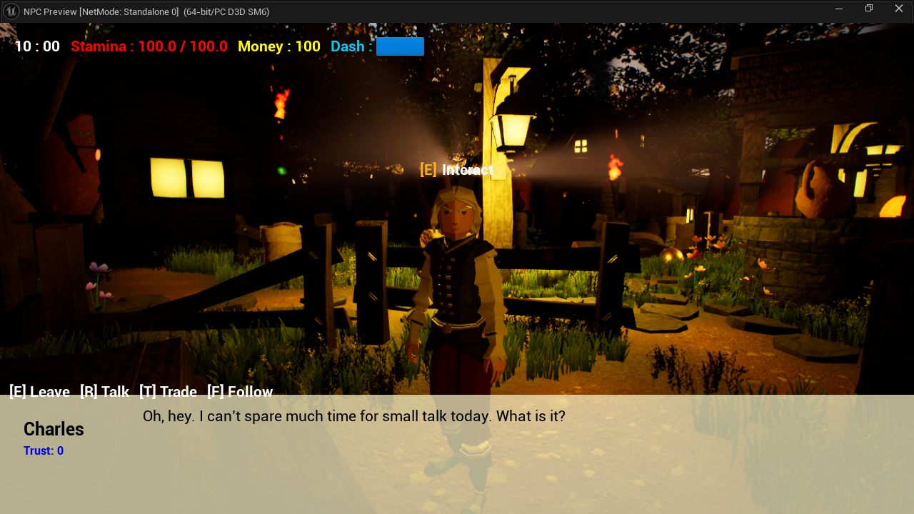
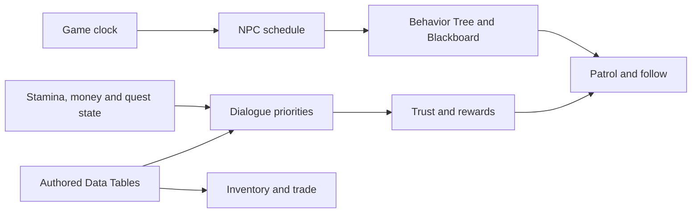
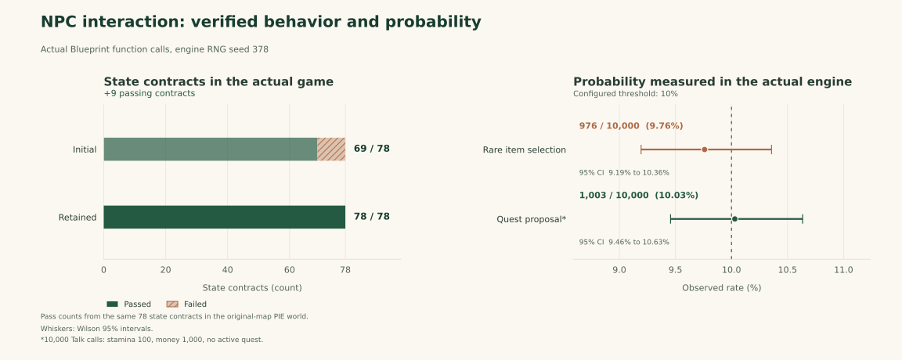

# Context-Aware NPC Interaction System

[English](README.md) | [한국어](README.ko.md)

An **NPC** (non-player character) is a game character controlled by the game.
Here, the player can approach a character, talk, trade, complete quests or ask
for company. Game time, stamina, money, quest progress and the relationship with
that character determine the resulting dialogue, available actions and movement.

A personal Unreal Engine project connecting five NPCs to daily schedules, state-aware dialogue, quests, trading, trust and companion behavior.

**Engine:** Unreal Engine 5.4.4  
**Original development:** September 2025 to June 2026  
**Implementation:** Blueprint, Behavior Tree, Blackboard, Data Tables and C++  
**Maintained source bundle:** version `1`

## Project overview

The project explores how an NPC's routine, relationship with the player and current game state can produce a connected gameplay loop. A shared clock drives schedules, dialogue priorities determine the appropriate response, and trust links conversations and quests to trading and following.

The playable game uses authored rules and actual Unreal AI behavior. A separate Qwen feasibility experiment did not consistently follow gameplay constraints and was not integrated into the game. The maintained release preserves the five-NPC framework while correcting specific interaction behavior and adding source restoration and actual-engine verification tools. Later maintenance is recorded separately from the original development period.



### How the Unreal components fit together

**Blueprint** is Unreal Engine's visual programming system: connected nodes
implement the game's rules. A **Behavior Tree** chooses actions such as patrolling
or following, using a **Blackboard** to share relevant state. **Data Tables**
hold authored NPC, item and quest information, while **UMG** builds the visible
dialogue, inventory and shop interfaces.

An **Actor** is an object placed in the game world. An overlap identifies nearby
objects inside a detection area; the player's Actor-forward vector describes
the direction the character faces. The target-selection rule uses those nearby
NPCs and that facing direction to choose whom the player interacts with.

## Key features

| System | Implementation | Gameplay result |
| --- | --- | --- |
| Daily routines | A 1,440-minute clock, NPC schedules, Behavior Tree and Blackboard state. | NPCs arrive, patrol and leave according to their authored schedules. |
| Contextual dialogue | Active quests are handled first. Without an active quest, low stamina and no money precede the original new-quest opportunity and ordinary dialogue. | Conversations respond to the player's condition while retaining quest progress. |
| Trust and companions | NPC-specific trust and interaction state control relationship-dependent actions. | Eligible NPCs can follow the player and return to their normal behavior. |
| Quests, inventory and trade | Data Tables define items, NPCs and quests; UMG widgets handle transactions and item use. | Conversations, collection, rewards, money and stamina form a shared gameplay loop. |
| Interaction targeting | Live NPC overlaps and the player's Actor-forward vector determine the highest directional score. | Interaction targets follow the character's facing direction. |
| Player systems | Sprinting, stamina, view switching, item pickup, inventory and shop interfaces. | NPC behavior can be explored in a playable environment. |



[Architecture and retained changes](docs/architecture.md) explains the original implementation, the dialogue correction and the interaction-preserving schedule guard.

[Inspect the Blueprint implementation](docs/blueprint-inspection.md) connects readable node, pin, data-table and task-setting exports to the actual Unreal assets.

## Recorded verification results

**Play in Editor (PIE)** runs the game inside the Unreal editor. A **state
contract** is a defined input state and an expected behavior: for example, a
particular stamina and quest state should lead to the corresponding dialogue
branch. A **fixture** prepares those conditions so the same check can be repeated.
Passing the contract count therefore means satisfying those recorded expectations,
not measuring a model's prediction accuracy.

The checks below execute the project's Blueprint functions on actual Play in Editor actors. Expected outcomes and fixtures are defined in the test source and reported JSON.



| Measurement | Recorded result | Scope |
| --- | --- | --- |
| Same state-contract set | **69/78 initially, 78/78 after correction** | Nine previously failing expectations addressed in the same scenario set. |
| Interaction target selection | **30/30 predefined conditions** | Three fixed original NPCs, confirmed overlaps and changes to player Actor yaw. |
| Conditional quest proposals | **1,003/10,000 calls, 10.03%** | Actual Talk path under an eligible, reset fixture; target threshold 10%. |
| Rare item selection | **976/10,000 calls, 9.76%** | Actual item-selection Blueprint and authored Data Table rows; target threshold 10%. |
| Final Blueprint compile inspection | **46/46, 0 errors, 0 warnings** | Includes the reviewed butterfly construction compatibility correction. |
| Actual navigation | **3/3 stages passed** | Native patrol, following and return to a reachable nearby home fixture. |
| Inventory input and respawn | **6/6 cases passed** | Actual PlayerController E input, item stacks, trust-filtered shop rows and the original 60-second respawn. |

The 78 contracts cover defined state fixtures. The 30 target cases exclude exact directional ties and verify Actor-forward selection. Probability measurements count conditional function calls; they are not 10,000 complete conversations, completed quests or player sessions. The navigation check preserves the authored task-instance speed of **150** and verifies runtime `MaxWalkSpeed`; its home fixture does not establish that every authored home coordinate is reachable. The input suite dispatches real engine input events, with physical keyboard focus outside its scope.

The probability rows compare how often an eligible random event occurred with
its configured threshold. The observed percentage can differ from that threshold
because the sample is finite. Each call resets the required conditions, so the
denominator describes controlled function calls rather than whole play sessions.

A **Tick** updates game objects during a frame. The workload comparison adds NPCs
to observe how the measured update span and frame interval change. The median
is the middle value after sorting measurements; lower elapsed times mean shorter
measured processing or waiting intervals under the stated conditions.

All **9 rendered workload runs** completed their validity checks: three runs each with 5, 20 and 50 NPCs. The table gives the **median of the three run medians**, rounded to three decimals.

| NPC count | World actor-tick span (ms) | Editor end-frame interval (ms) |
| ---: | ---: | ---: |
| 5 | 4.761 | 15.171 |
| 20 | 8.799 | 15.684 |
| 50 | 16.752 | 23.868 |

World actor-tick spans include other actors and intervening world work. Editor intervals include PIE, rendering waits and instrumentation. They are not isolated NPC CPU time or standalone packaged-game FPS. [Results and evidence](docs/results.md) provides run variation, movement checks and the recorded rendering conditions.

The original 79-page report, its 11 feature checks and its 100-trial probability measurements remain preserved as **initial development records**. Those smaller samples recorded 11 quest events and 14 rare-item events per 100 observations. The maintained measurements have their own conditions and denominators. [Results and evidence](docs/results.md) separates the original records, valid correction checks, declined optimization experiments and source-bound release results.

## Download and reproduce

- **Current source and verification bundle:** [download `npc-source-and-verification.zip`](https://github.com/Dongmyung378/Context-Aware-Npc-System/raw/refs/heads/main/downloads/npc-source-and-verification.zip), then follow the [restoration guide](docs/reproduce.md).
- **Original complete project:** [download `Project.zip` manually from Drive](https://drive.google.com/file/d/1qsdGAzKU3myKQVk04MfW-EngDHKKAqmW/view?usp=sharing).
- **Recorded demonstrations:** [screencasts and supporting material](https://drive.google.com/drive/folders/1NyVitLN8_N_IztialbqUIZ3nomCIZ69q?usp=sharing).

An **overlay** contains the explicit replacement and additional files to apply
to the original project. A **manifest** lists the expected files and their content
hashes; a hash is used to check whether a file's contents match the recorded
version. These are restoration and integrity tools, while the engine checks
below test actual gameplay behavior.

The full original archive is a separate dependency: **2,257,866,122 bytes**, approximately 2.26 GB. The current compact bundle supplies the reviewed overlay, editor verification plugin source, manifests, tools and documentation. The restoration tool combines these inputs in a new directory and verifies the complete final source tree. The historical thirty-asset core ZIP is an inspection package and cannot run the full game on its own.

The repository ZIP uses the name shown above. The website download may use a different filename for the same bundle contents. The [restoration guide](docs/reproduce.md#what-to-download) records the pinned original archive SHA-256.

From the extracted current bundle, with the original archive downloaded separately:

```powershell
python -X utf8 -B tools/verify_bundle.py --expected-source-version 1
python -X utf8 -B tools/restore_project.py --archive "D:/Downloads/Project.zip" --output "D:/NPC-Verify" --expected-source-version 1
```

Use a new output directory whose parent exists. Then follow [the source-build and engine-check instructions](docs/reproduce.md#build-and-run-the-actual-engine-checks). Unreal Engine 5.4.4, a compatible Visual Studio C++ toolchain and Windows SDK are required. Open the restored `NPC.uproject`, load `/Game/ThirdPerson/Maps/ThirdPersonMap` and start Play in Editor for manual inspection.

Python restoration and manifest tests cover Windows and Linux tool behavior. Actual game execution is scoped to the recorded **Windows Unreal Engine 5.4.4** environment. A same-machine fresh restoration and source build remain distinct from validation on an independent computer. Engine logs, automation JSON and source manifests define the evidence for each run; a successful Python file check alone does not establish gameplay correctness.

The recorded fresh restoration verified **2,371 project source-tree files**, applying **29 overlay files: 7 replacements and 22 additions**. The initial source build from that restored tree completed **29 build actions in 53.02 seconds** in the recorded Windows environment. A subsequent validation run on the same restored project also passed **all seven actual gameplay suites** and compiled **46/46 Blueprints with zero errors and zero warnings**. The [fresh-restoration run report](reports/fresh-restoration/run.json) records the subsequent build check and engine results; its build-check duration is separate from the initial source build above.

## Controls

| Input | Action |
| --- | --- |
| `W` `A` `S` `D` | Move |
| `Left Shift` | Sprint |
| `V` | Switch first-/third-person view |
| `E` | Interact, pick up an item or close dialogue |
| `I` | Open or close inventory |
| `R` | Talk or continue a conversation |
| `T` | Open trade |
| `F` | Request or stop following when conditions permit |

## Repository and bundle guide

| Location | Purpose |
| --- | --- |
| `docs/` | Architecture, results and reproduction guides in English and Korean. |
| [Blueprint inspection guide](docs/blueprint-inspection.md) | How to review the actual binary-asset implementation through exported graphs and authored settings. |
| [inspections/](inspections/README.md) | Initial and maintained Blueprint graphs, Data Table rows, Behavior Tree task settings and export hashes. |
| `reports/` | Public actual-engine JSON with explicit cases, sample counts and limitations. |
| `evidence/` | Release restoration, source-build and verification summaries. |
| `figures/` | Visual summaries derived from the reported measurements. |
| `tools/` | Offline verification/restoration, release authoring and actual Unreal check runner. |
| `tests/` | Synthetic tests of the Python tools, kept separate from Unreal gameplay tests. |
| `overlay/` | Explicit source/configuration/asset replacements and additions, including editor plugin source. |
| `manifests/` and `bundle.json` | Original, overlay, final source and release payload hashes. |
| Historical `docs/`, `downloads/`, `unreal-assets/` | Preserved original report, presentation, compact archive and public core assets in the repository. |

Historical material remains accessible from the repository and is excluded from the compact execution bundle:

- [Original report](https://github.com/Dongmyung378/Context-Aware-Npc-System/blob/main/docs/project-report.pdf)
- [Original presentation](https://github.com/Dongmyung378/Context-Aware-Npc-System/blob/main/docs/project-presentation.pptx)
- [Initial core asset ZIP](https://github.com/Dongmyung378/Context-Aware-Npc-System/blob/main/downloads/npc-core-assets.zip)
- [Initial Unreal asset index](https://github.com/Dongmyung378/Context-Aware-Npc-System/blob/main/unreal-assets/README.md)

Generated Unreal binaries, caches and personal editor settings are outside the source bundle. The complete original archive and final overlay manifests preserve a reviewable relationship between the initial project and maintained source.

## Author

Dongmyung Park  
BSc Artificial Intelligence / Third Year Project / 2026
