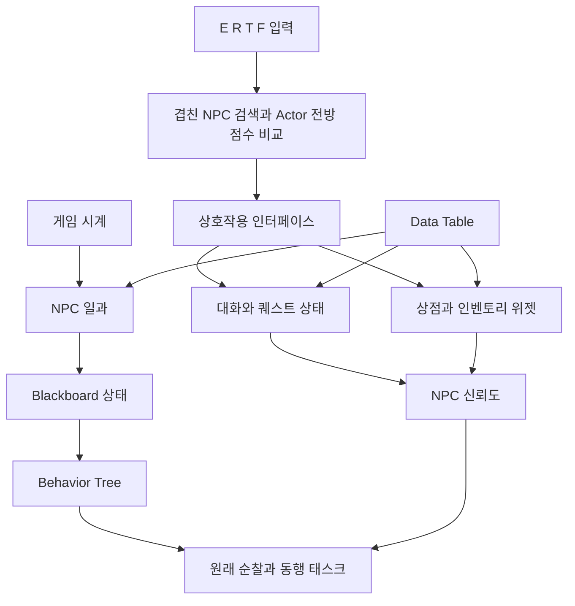
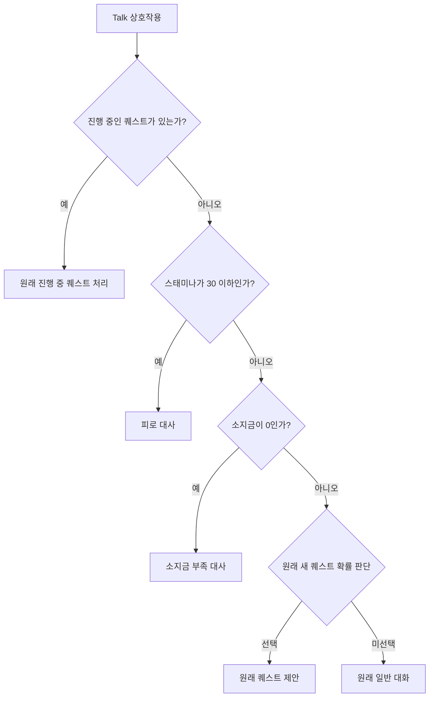

# 시스템 구조

[English](architecture.md) | 한국어

이 프로젝트는 다섯 NPC의 일과, 상황별 대화, 퀘스트, 거래, 신뢰도와 동행 행동을 하나의 게임 흐름으로 연결합니다. 최종 유지한 구현은 Unreal Engine 5.4.4의 Blueprint, Behavior Tree, Blackboard와 Data Table을 사용합니다. 최초 개발 기간은 2025년 9월부터 2026년 6월까지이며, 2026년 10월의 검증과 유지보수는 별도로 구분합니다.

NPC는 게임이 행동을 결정하는 캐릭터입니다. 이 구조는 플레이어 입력과
현재 상태를 직접 작성한 대화, 거래와 이동에 연결합니다. Blueprint 그래프는
규칙을 구현하고, Behavior Tree는 Blackboard에 공유한 상태를 참고해 이동
작업을 선택합니다. Data Table은 직접 작성한 콘텐츠 정보를 공급하며,
UMG 위젯은 대화창과 인벤토리, 상점의 화면과 조작 요소를 구성합니다.

Actor는 게임 공간의 객체이고, Tick은 프레임마다 상태를 갱신하는 처리
기회입니다. 작업은 행동 트리가 선택하는 실행 단위이며, guard는 동작을
진행하기 전에 확인하는 조건입니다. 아래의 시간표 수정에서는 상호작용
중에 새로운 귀가 의도를 설정하지 못하도록 이 조건을 사용하며 이동
시스템 자체를 교체하지 않습니다.

## 실행 시 역할 분담

| 구성 요소 | 역할 |
| --- | --- |
| `BP_GameMode` | NPC 일과의 기준이 되는 하루 1,440분 게임 시계를 진행합니다. |
| `BP_NPC_Standard` | NPC별 상호작용, 퀘스트, 신뢰도, 일과와 동행 상태를 관리합니다. |
| `My_AIController`, `BT_NPC`, `BB_NPC` | 원래 이동 태스크와 행동 상태를 연결합니다. |
| `BP_ThirdPersonCharacter` | 플레이어의 스태미나, 소지금, 인벤토리와 상호작용 대상 선택을 관리합니다. |
| `BPI_Interaction` | 선택한 상호작용을 실제 NPC 구현으로 전달합니다. |
| `BP_Item_Master` | 일반 또는 희귀 아이템 행을 선택하고 메시, 재질과 게임 데이터를 적용합니다. |
| `WBP_InventoryMain`, `WBP_ShopMain`, `WBP_InventoryLine` | 아이템 행을 구성하고 사용, 구매와 묶음 판매를 처리합니다. |

C++ 런타임 모듈은 원래 캐릭터와 게임 모드의 기반을 제공합니다. 사용자 정의 게임 규칙은 기존 Blueprint 클래스에 유지했습니다. 에디터 전용 `NpcAudit` 플러그인은 해당 클래스를 검사하고 검증하는 도구이며 게임 구현을 대체하지 않습니다.

## 작성한 게임 데이터

원본 테이블에는 `DT_NPC_Data`의 NPC 5개, `DT_Item_Data`의 아이템 38개, `DT_QuestList`의 퀘스트 15개 행이 있습니다. 이는 콘텐츠 수이며 독립적인 알고리즘이나 시험 수가 아닙니다. 구조체와 열거형이 데이터 형식을 정의하고, 미리 작성한 대화 맵이 실제 대사를 제공합니다.

NPC 행에는 일과와 관계 데이터가 들어 있습니다. 아이템 행은 이름, 유형, 가격, 수량, 회복 효과, 신뢰도와 표시 자산을 연결합니다. 퀘스트 행은 수행 조건과 보상을 정의합니다. 이러한 분리는 상호작용 구조를 교체하지 않고 콘텐츠를 조정할 수 있게 합니다.

`BP_Mushroom`은 생성 클래스 별칭을 포함해 `BP_Item_Master`를 가리키는 이전 경로의 ObjectRedirector입니다. 별개의 아이템 알고리즘이 아닙니다. 검사 도구는 실제 대상 Blueprint를 확인한 뒤 생성 클래스를 가져와야 합니다.

## 상호작용 대상 선택

E, R, T, F는 각각 `Interact`, `Talk`, `Trade`, `Follow`를 `BP_ThirdPersonCharacter.SendInteractionSignal`에 전달합니다. 함수는 호출마다 `BestTarget`을 비우고 `BestScore`를 -1로 초기화합니다. 이후 플레이어와 겹친 Actor 중 `BP_NPC_Standard`에 해당하는 대상을 찾고 `GetDotProductTo` 값이 가장 큰 NPC를 선택합니다.

방향 기준은 플레이어의 **Actor 전방 벡터**입니다. 대상 선택은 입력 경로에서 실행하며 매 Tick마다 검색하지 않습니다. 카메라 전방을 기준으로 삼거나 별도의 전방 각도 제한을 적용하지 않으며, 동점 처리 규칙도 따로 작성되어 있지 않습니다. 따라서 검증 행렬은 방향 점수가 다른 조건과 미리 정한 NPC 정답을 사용하며 새로운 동점 규칙을 만들지 않습니다.

실제 엔진 검증에서는 세 NPC의 위치를 고정하고 플레이어 Actor만 회전합니다. 시험 대상 NPC를 표시 및 충돌 활성 상태로 준비하고, 검증 후 원래 플래그와 위치를 복구합니다. 이는 방향 선택과 일정상 등장 조건을 분리하기 위한 전제입니다. 비활동 NPC는 정상 귀가 후 충돌이 꺼져 있을 수 있습니다. 세 NPC가 실제 겹침 목록에 남아 있는지 확인한 뒤 기존 함수를 호출합니다. 별도 조건에서는 겹침을 해제하고 이전 대상과 점수가 초기화되는지 확인합니다. 선택 검증용 키는 기존 인터페이스에서 연결되지 않은 기본 분기로 전달하므로, 선택을 확인하면서 대화나 동행 상태까지 함께 바꾸지 않습니다.

## 최종 유지한 대화 우선순위

대화 수정 범위는 **진행 중인 퀘스트가 없는 Talk 경로**입니다. 진행 중인 퀘스트의 처리는 여전히 먼저 실행하며, 원래 완료 판정과 조건 및 보상 처리를 유지했습니다. 진행 중인 퀘스트가 없으면 다음 순서로 처리합니다.

1. `Current_Stamina <= 30`이면 피로 대사를 표시합니다.
2. 그렇지 않고 `Money == 0`이면 소지금 부족 대사를 표시합니다.
3. 두 조건에 해당하지 않으면 원래 0.1 확률의 새 퀘스트 기회를 판단합니다.
4. 새 퀘스트를 제안하지 않으면 원래 일반 대화 경로로 이어집니다.

스태미나 31은 피로 분기에 해당하지 않습니다. 별도의 체력 값이 아니라 스태미나 변수입니다. 진행 중인 퀘스트가 없고 두 긴급 조건이 겹치면 피로 대사가 우선합니다. 이 수정이 진행 중인 퀘스트보다 긴급 대사를 우선하게 만드는 것은 아닙니다.

최초 그래프에서는 일반 스태미나와 소지금 조건보다 새 퀘스트 확률을 먼저 판단했습니다. 최종 수정은 진행 중인 퀘스트를 유지하면서 긴급 조건을 새 퀘스트 판단 앞으로 옮깁니다. 원래 보고서는 당시 동작을 기록한 자료이므로, 최종 그래프의 정확한 명세로 해석하기보다 이 정정 내용과 함께 읽어야 합니다.

## 일과와 진행 중인 상호작용

일과는 원래처럼 매 프레임 평가합니다. 활동 시간 안의 기존 일정 경로는 유지했습니다. 활동 시간 밖에서는 새 `IsInteracting` 조건이 대화나 거래 중인 NPC에 새로운 귀가 의도를 설정하지 않도록 합니다. 상호작용을 닫으면 다음 일정 평가에서 원래 귀가 경로를 다시 실행할 수 있습니다.

이 조건은 Behavior Tree를 재작성하거나 출퇴근 시간을 바꾸지 않습니다. 이미 발행한 모든 이동 요청을 취소하거나 NPC의 다른 Tick 처리를 끄는 기능도 아닙니다. 보장 범위는 진행 중인 상호작용 도중 일정 분기가 새로운 귀가 의도를 발행하지 않는 것입니다. 조건 이후의 원래 귀가 이동과 도착 처리는 유지했습니다.

## 아이템, 거래와 확률

원래 인벤토리 행은 한 개 구매, 선택한 묶음 전체 판매, 한 개 사용을 처리합니다. 구매는 가격과 소지금을 비교한 뒤 일치하는 묶음의 수량을 늘리거나 새 아이템을 추가합니다. 판매는 묶음 수량에 따라 소지금과 NPC 신뢰도를 변경합니다. 일반 음식은 원래 최대값 제한을 적용해 스태미나를 회복하고, 특수 음식은 이동 속도, 최대 스태미나 또는 스태미나 감소량을 변경합니다.

Gathering 유형은 원래 구매 버튼을 숨깁니다. 따라서 수집한 아이템은 판매 시험에는 적절해도 구매 시험에는 적절하지 않을 수 있습니다. 실제 UI 검증에서는 일반 음식을 구매하고 희귀 수집품을 판매합니다. 원래 상위 화면을 생성한 뒤 그 화면이 만든 행의 실제 버튼을 호출하며, 숨겨졌거나 비활성화된 버튼을 강제로 클릭하지 않습니다.

`BP_Item_Master.DecideItem`은 원래 난수 비교를 수행해 일반 행 또는 `Rare_` 행을 선택하고 데이터, 메시와 재질을 적용합니다. 비교식은 `random_draw <= 0.1`입니다. 별도 장식자인 `BTD_RandomChance.PerformConditionCheck`는 `random_draw < Chance`를 사용합니다. 클래스 기본값, Behavior Tree 내부 인스턴스 값, 시험 인스턴스 설정은 서로 다른 범위이므로 구분해 기록해야 합니다. 장식자를 호출한 것만으로 퀘스트 제안이나 보상이 실행됐다고 볼 수는 없습니다.

## 검토 가능한 Blueprint 변경

최종 대화와 일정 규칙 수정은 [NPC Blueprint](../overlay/Content/ThirdPerson/Blueprints/BP_NPC_Standard.uasset)에 한정합니다. 유지보수 함수 `NpcBlueprintPatchLibrary::CorrectNpcBlueprint`는 검토한 노드 GUID와 최초 연결을 확인한 뒤 변경합니다. 대화 수정은 기존 실행 연결 세 개를 재배치합니다. 일정 수정은 GUID가 `15C20261-0C15-4F2A-AB80-1D0180000001`인 분기 하나를 추가하고, 거짓 출력을 원래 귀가 의도 노드에 연결합니다.

| 역할 | 검토한 최초 노드 GUID |
| --- | --- |
| 진행 중 퀘스트 분기 | `03A23920-4C29-D6EE-2BF3-33B9586AE665` |
| 새 퀘스트 확률 분기 | `5166DE7F-4BFA-ED5E-573F-F3879C1BD329` |
| 플레이어 상태 확인 진입 | `3985C114-4B65-FBBC-4680-63A218085D37` |
| 소지금 분기 | `72C0987B-4585-79D3-EEF3-3884D9F01F2D` |
| 일반 대화 진입 | `C50A5832-4BCE-3C57-613A-FB8AE31105B1` |
| 일정 분기 | `9DB60F60-464F-F40E-45E5-4CAE6E1BA158` |
| 원래 귀가 의도 노드 | `B83AADD6-49F0-407A-4574-B081B9623A81` |

그래프 내보내기는 노드 GUID, 함수 참조, 핀, 기본값과 연결을 공개해 바이너리 Blueprint의 동작을 다른 구현으로 바꾸지 않고 검토할 수 있게 합니다. 유지보수 함수는 `SkipSave`로 메모리에서 컴파일하며, 실제 자산 저장은 유지보수 작업에서 명시적으로 제어합니다. 초기 자산, 보고서와 실험 결과는 별도로 보존합니다. 원래 [프로젝트 보고서](https://github.com/Dongmyung378/Context-Aware-Npc-System/blob/main/docs/project-report.pdf)와 [발표 자료](https://github.com/Dongmyung378/Context-Aware-Npc-System/blob/main/docs/project-presentation.pptx)는 당시 결과를 담은 자료로 유지합니다.

## 환경과 내비게이션 유지보수

대화와 일정 수정은 전체 장면을 복원하는 데 필요한 환경 보완과 구분합니다. 마을 콘텐츠의 `BP_Butterfly`는 생성 스크립트에서 `PlayAnimation`과 `SetPlayRate`를 호출했습니다. 검토한 외부 콘텐츠 수정은 이 초기화를 생성 스크립트에서 사용할 수 있는 `USkeletalMeshComponent::OverrideAnimationData`로 바꿉니다. 원래 애니메이션 배열 선택과 재생 속도 계산을 유지하고, 단일 노드 애니메이션을 반복 재생 상태로 초기화하며 시작 위치는 0입니다. 관련 없는 그래프와 Event Graph는 유지합니다. 경고 없는 컴파일 결과는 생성 스크립트의 호환성을 확인하는 근거이며, 화면 미리보기와 실제 재생은 별도의 엔진 검증이 필요합니다.

내비게이션 유지보수는 기존 맵과 내비게이션 설정을 사용합니다. Recast Actor가 있거나 타일 슬롯이 할당되어 있다는 사실만으로 유효한 이동 영역을 확인할 수는 없습니다. 복원 경로는 원래 내비게이션 범위 안의 지형을 로드하며, 겹치는 마을 레벨 인스턴스와 그 하위 지형도 포함합니다. 대기 중인 내비게이션 작업을 마친 뒤 엔진의 명시적 내비게이션 빌드를 실행합니다. 스트리밍 완료만 기다리면 레벨 인스턴스의 지형이 여전히 대기 중일 수 있으므로, 유지보수 함수는 빌드 전에 엔진의 레벨 인스턴스 로드 완료 절차도 사용합니다.

`NpcMaintenanceLibrary`는 `LoadNavigationGeometry`, `WaitForNavigationBuild`, `RebuildNavigation`, `SaveReviewedPackages`를 분리합니다. 재빌드에서는 원래 내비게이션 설정과 Actor의 소스 플래그를 유지했는지 확인합니다. 범위를 넓히거나 에이전트 크기를 바꾸지 않으며, 이동 시스템이나 경로 탐색기를 새로 구현하지 않습니다. 검토한 맵과 내비게이션 패키지만 저장하고 패키지 기록을 남깁니다. 각 패키지의 저장은 개별 작업이므로 여러 파일을 한 번에 확정하는 원자적 트랜잭션은 아닙니다.

소스 변경 번들과 최종 manifest에는 게임 규칙 및 외부 콘텐츠 변경과 함께 저장한 맵 및 내비게이션 패키지도 포함해야 합니다. 이후 새 에디터 세션에서 복원한 소스를 열고 실제 내비게이션 검증을 실행합니다. 순찰, 동행과 귀가 단계는 월드 Tick, 네이티브 경로 추종 상태, 좌표와 완료 콜백을 관측합니다. 내비게이션 재빌드는 이 검증의 준비이며 모든 단계나 작성한 목적지의 도달 가능성이 통과했다는 주장은 아닙니다. 최종 이동 근거는 [결과 문서](results.ko.md)에서 별도로 설명합니다.

작성된 `BT_NPC`의 추종 태스크 인스턴스는 `ChaseSpeed`를 150으로 설정하며, Blueprint 클래스 기본값인 300과 다릅니다. 순찰 태스크 인스턴스도 150입니다. 이는 `MaxWalkSpeed` 설정값이며 실제 이동 속도가 항상 일정하다는 뜻은 아닙니다. 게임 속도와 원래 `BT_NPC` 자산은 유지했습니다. 검증은 실제 트리의 태스크 인스턴스 값을 기대값으로 읽고 런타임 `NodeInstances` 및 이동 설정과 대조합니다. 클래스 기본값을 잘못 사용한 기대값을 바로잡은 것은 시험의 정정이며 게임의 동행 속도 수정이 아닙니다.

## 검토했으나 채택하지 않은 최적화

별도 후보에서는 Tick마다 수행하던 GameMode 조회와 캐스팅 세 쌍을 Sequence 앞으로 옮겨 세 분기가 하나의 조회를 공유하게 했습니다. 분기 순서와 매 프레임 평가는 유지했고 BeginPlay 캐시는 추가하지 않았습니다. 이 후보는 **채택하지 않았습니다**. 50개 NPC 조건의 세 실행 중앙값을 다시 중앙값으로 비교했을 때 측정값은 12.97435ms에서 12.4509ms로 약 4.03% 감소했지만, 사전에 정한 채택 기준인 5%에 미치지 못했습니다. 위 게임 규칙 수정을 최종 유지하기 전에 원래 조회 구조로 복원했습니다.

이 후보 비교는 같은 최초 소스의 작업 부하를 사용했으며, 측정값은 PIE 월드의 `OnWorldPreActorTick`부터 `OnWorldPostActorTick`까지의 구간으로 모든 Actor와 그 사이 작업을 포함합니다. NPC만의 CPU 시간, GPU 프레임 시간이나 패키징한 게임의 FPS가 아닙니다. NPC 50개 조건은 원래 다섯 NPC에 복제 인스턴스 45개를 더한 구성입니다. 이때 활동 중인 NPC 수는 표시 상태, 충돌 활성화와 해당 Blackboard 값으로 정의했으며, 실제로 유효한 경로를 따라 걷고 있다는 증거는 아닙니다. 이 비교를 내비게이션까지 검증한 부하 시험이나 최종 배포본의 성능 개선으로 설명할 수 없습니다. 내비게이션을 복원한 뒤의 측정은 작업 부하가 달라지므로 최초 시간과 비교해 FPS 개선이나 회귀를 주장하지 않습니다. 그래프를 간소화했다는 사실만으로 전체 실행 성능이 개선됐다고 설명할 수는 없습니다.

## 재현과 검증 범위

공개 핵심 자산 30개는 중심 구현을 보여주지만 플레이에 필요한 모든 의존성을 포함하지 않습니다. 전체 복원에는 원래 맵, World Partition 외부 패키지, 표시 자산, 소스와 설정도 필요합니다. Unreal 패키지 경로를 유지하고 [복원 가이드](reproduce.ko.md)에 따라 준비한 뒤 에디터 전용 자동화 플러그인을 실행해야 합니다. 원본 압축 파일은 유지보수 변경 번들과 구분해 보존하고, 초기 및 최종 유지 자산은 manifest로 식별합니다.

실제 Blueprint 호출과 원래 맵의 PIE 상태 검증은 규칙을 외부에서 다시 구현한 검사보다 직접적인 근거를 제공합니다. UMG 이벤트 검증은 원래 처리 함수와 상태 변화를 확인하지만 시각적 배치나 물리적인 마우스 입력까지 확인하지는 않습니다. NullRHI 결과로 렌더링 품질을 주장할 수 없으며, 내비게이션 관련 자산을 로드하거나 컴파일한 것만으로 도달 가능성을 확인할 수도 없습니다. 이동, 경로의 존재와 베이크된 내비게이션 데이터는 실제 엔진에서 별도로 검증하고 기록해야 합니다.

플레이 가능한 NPC 시스템은 규칙 기반입니다. 원래 별도로 진행한 Qwen 적용 가능성 실험은 게임 제약을 일관되게 만족하지 못해 통합하지 않았습니다. 그 기록을 현재 대화가 LLM 에이전트라는 근거로 사용할 수 없으며, 여기서 설명한 게임에는 외부 언어 모델 서비스가 필요하지 않습니다.
