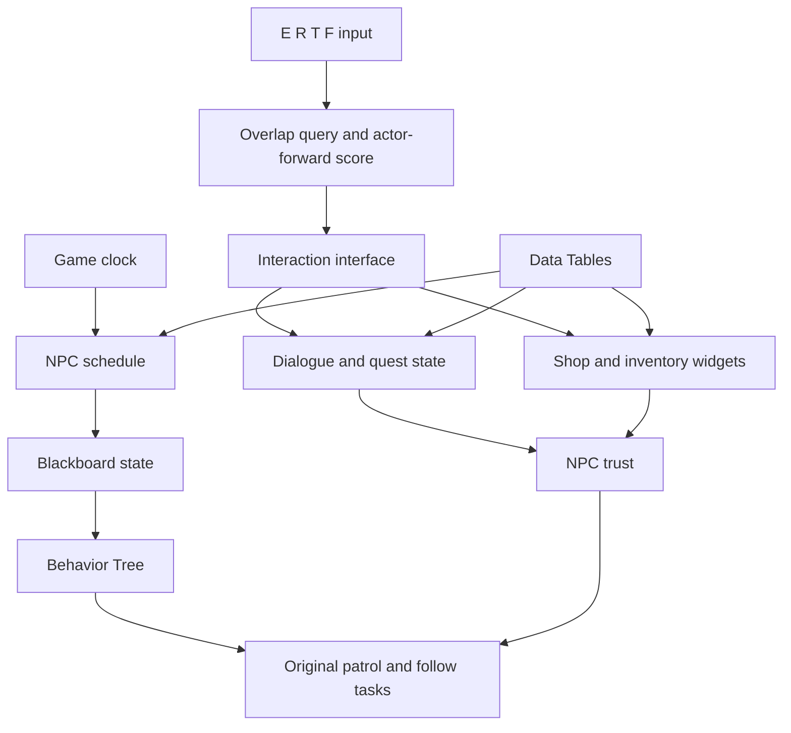
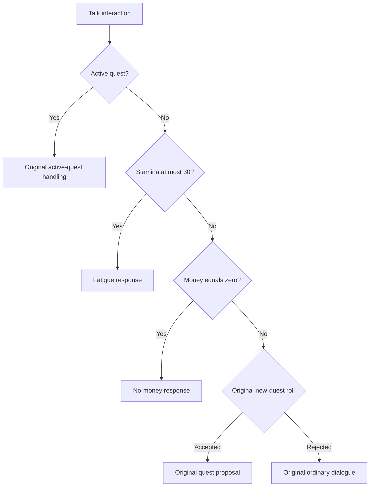

# Architecture

[English](architecture.md) | [한국어](architecture.ko.md)

The project connects five authored NPCs to a shared game clock, contextual dialogue, quests, trade, trust and companion behavior. The retained gameplay implementation uses Unreal Engine 5.4.4 Blueprint, Behavior Tree, Blackboard and Data Tables. Original development ran from September 2025 to June 2026; verification and maintenance in October 2026 are recorded separately.

## Runtime responsibilities

| Component | Responsibility |
| --- | --- |
| `BP_GameMode` | Advance the 1,440-minute game clock used by NPC schedules. |
| `BP_NPC_Standard` | Maintain an NPC's interaction, quest, trust, schedule and follow state. |
| `My_AIController`, `BT_NPC`, `BB_NPC` | Coordinate the original movement tasks and behavior state. |
| `BP_ThirdPersonCharacter` | Own player stamina, money, inventory and interaction target selection. |
| `BPI_Interaction` | Dispatch the selected interaction to the actual NPC implementation. |
| `BP_Item_Master` | Select a normal or rare item row and apply its mesh, material and gameplay data. |
| `WBP_InventoryMain`, `WBP_ShopMain`, `WBP_InventoryLine` | Construct item lines and handle item use, purchases and stack sales. |

The C++ runtime module provides the original character and game-mode foundation. Custom gameplay rules remain in the original generated Blueprint classes. The editor-only `NpcAudit` plugin inspects and tests those classes; it is not a replacement game implementation.

## Authored data

The inspected original tables contain five NPC rows in `DT_NPC_Data`, 38 item rows in `DT_Item_Data`, and 15 quest rows in `DT_QuestList`. These counts describe content rather than independent algorithms or test cases. Structures and enums define the row schemas, while authored dialogue maps supply the actual lines.

NPC rows include schedule and relationship data. Item rows connect names, item type, price, quantity, restoration effects, trust points and presentation assets. Quest rows define requirements and rewards. This separation allows content changes without replacing the interaction framework.

`BP_Mushroom` is a legacy ObjectRedirector to `BP_Item_Master`, including generated-class aliases. It is not a separate item algorithm. Tools inspecting it should resolve the destination Blueprint before requesting its generated class.

## Interaction target selection

E, R, T and F pass `Interact`, `Talk`, `Trade` and `Follow` respectively to `BP_ThirdPersonCharacter.SendInteractionSignal`. Each invocation clears `BestTarget`, resets `BestScore` to -1, queries overlapping actors filtered to `BP_NPC_Standard`, and selects the largest `GetDotProductTo` result.

The direction is the player's **actor-forward vector**. Selection runs on the input path, not every Tick. It does not use camera-forward targeting, an additional front-only angular cutoff, or an authored equal-score tie rule. The test matrix therefore uses distinct direction scores and predeclared expected NPC indices rather than inventing tie behavior.

The real-engine matrix keeps three NPC positions fixed, rotates only the actual player Actor, confirms that all three remain in the live overlap set, and calls the original function. It explicitly prepares those test NPCs as visible and collision-enabled, then restores their prior flags and transforms. This isolates direction selection from scheduled availability; an off-duty NPC can correctly have collision disabled after arriving home. A separate case clears the overlaps and checks that the previous target and score are reset. The selection-only test key reaches the original interface's unused default branch, allowing selection to be measured without also opening dialogue or changing follow state.

## Retained dialogue priority

The maintenance change is limited to the **no-active-quest Talk path**. Active quest handling remains first and retains the original completion, requirement and reward logic. Without an active quest, the retained order is:

1. `Current_Stamina <= 30`: show the fatigue response.
2. Otherwise, `Money == 0`: show the no-money response.
3. Otherwise, evaluate the original 0.1 new-quest opportunity.
4. Otherwise, continue to the original ordinary dialogue path.

Stamina 31 is outside the fatigue branch. The variable is stamina, not a separate health value. If both critical conditions apply and no quest is active, fatigue takes precedence. This change does not make critical warnings override an already active quest.

In the initial graph, the new-quest roll preceded these ordinary stamina and money checks. The retained change moves the critical checks before that new roll while preserving active quests. Consequently, the original report describes historical behavior and should be read alongside this correction rather than treated as an exact specification of the retained graph.

## Schedule and active interactions

The original schedule continues to evaluate every frame. In working hours, the original active schedule path is unchanged. Outside working hours, a new `IsInteracting` guard prevents the schedule branch from issuing a new home intent while dialogue or trade is open. When the interaction closes, the next schedule evaluation can resume the original return-home path.

This guard does not rewrite the Behavior Tree, change NPC hours, cancel every previously issued movement request, or disable the rest of the NPC Tick. Its contract concerns issuing a new home intent during an active interaction. The original return-home movement and its completion handling remain downstream of the guard.

## Items, trade and probability

The original inventory line buys one unit, sells the selected stack, or consumes one unit. Buying checks the price against player money and either increments a matching stack or adds an item. Selling uses stack quantity to update money and NPC trust. Ordinary food restores stamina with the original maximum clamp. The original special foods modify movement speed, maximum stamina or stamina reduction.

The Gathering item category intentionally hides its buy button. A collected item can therefore be a valid sale fixture without being a valid purchase fixture. Actual UI tests use an ordinary food for purchases and a collected rare item for sales. They construct the original top-level containers and exercise the real line buttons; hidden or disabled buttons are not forcibly clicked.

`BP_Item_Master.DecideItem` performs the original random comparison, chooses the normal or `Rare_` row, and applies the row's data, mesh and material. Its comparison is `random_draw <= 0.1`. The separate `BTD_RandomChance.PerformConditionCheck` uses `random_draw < Chance`. Class defaults, Behavior Tree instance settings and test-instance chance values are different scopes and must be reported separately. A decorator call does not by itself prove quest proposal or reward execution.

## Auditable Blueprint changes

The retained dialogue and schedule corrections are confined to [the maintained NPC Blueprint overlay](../overlay/Content/ThirdPerson/Blueprints/BP_NPC_Standard.uasset). The maintenance helper `NpcBlueprintPatchLibrary::CorrectNpcBlueprint` checks reviewed node GUIDs and initial links before changing them. The dialogue patch redirects three existing execution links. The schedule patch adds one branch with GUID `15C20261-0C15-4F2A-AB80-1D0180000001` and connects its false output to the original home-intent node.

| Role | Reviewed original node GUID |
| --- | --- |
| Active quest branch | `03A23920-4C29-D6EE-2BF3-33B9586AE665` |
| New-quest roll branch | `5166DE7F-4BFA-ED5E-573F-F3879C1BD329` |
| Player-state entry | `3985C114-4B65-FBBC-4680-63A218085D37` |
| Money branch | `72C0987B-4585-79D3-EEF3-3884D9F01F2D` |
| Ordinary dialogue entry | `C50A5832-4BCE-3C57-613A-FB8AE31105B1` |
| Schedule branch | `9DB60F60-464F-F40E-45E5-4CAE6E1BA158` |
| Original home-intent node | `B83AADD6-49F0-407A-4574-B081B9623A81` |

Graph exports expose node GUIDs, function references, pins, defaults and links for review without converting binary Blueprint logic into a different implementation. The helper compiles in memory with `SkipSave`; the maintainer explicitly controls asset saving. Initial assets, reports and experiment outputs remain separately preserved. The original [project report](https://github.com/Dongmyung378/Context-Aware-Npc-System/blob/main/docs/project-report.pdf) and [presentation](https://github.com/Dongmyung378/Context-Aware-Npc-System/blob/main/docs/project-presentation.pptx) remain historical documents.

## Environment and navigation maintenance

The dialogue and schedule corrections are separate from the environment maintenance needed to restore the full scene. In the village content, `BP_Butterfly` previously called `PlayAnimation` and `SetPlayRate` from its construction script. The reviewed vendor patch replaces that initialization with construction-safe `USkeletalMeshComponent::OverrideAnimationData`. It retains the original animation-array selection and rate expression, with single-node animation, looping and playing enabled, and initial position zero. The unrelated graph snapshot and Event Graph remain unchanged. A clean compiler result establishes construction-script compatibility; visual preview and runtime animation still require their own engine checks.

Navigation maintenance uses the existing map and navigation configuration. A Recast actor or allocated tile slots alone do not establish usable navigation geometry. The restoration path loads geometry within the original navigation bounds, including the intersecting village level instance and its child geometry, waits for queued navigation work, and performs an explicit engine navigation build. A plain streaming flush can leave a level instance's geometry queued, so the maintenance helper also uses the engine's blocking level-instance load before building.

`NpcMaintenanceLibrary` separates `LoadNavigationGeometry`, `WaitForNavigationBuild`, `RebuildNavigation` and `SaveReviewedPackages`. The rebuild checks that the original navigation configuration and source actor flags are retained. It does not enlarge bounds, change agent dimensions, replace the movement system or implement a second pathfinder. Saving is limited to reviewed map/navigation packages and recorded in a package journal; independent package saves are not a multi-file atomic transaction.

The source overlay and final manifest must carry those saved map/navigation packages along with the gameplay and vendor changes. A fresh editor session must then load the restored source and execute the actual navigation suite. The tested patrol, follow and home stages observe world ticks, native path-following state, coordinates and completion callbacks. A repaired navigation build is preparation for those checks, not a claim that every stage or authored destination has passed. Final movement evidence is reported separately in [the results](results.md).

The authored `BT_NPC` chase-task instance sets `ChaseSpeed` to 150 even though its Blueprint class default is 300. The authored patrol-task instance is also 150. Those are configured `MaxWalkSpeed` values, not a claim of constant measured velocity. The game speed and original `BT_NPC` asset are retained. The test oracle reads the actual tree's task-instance overrides and checks runtime `NodeInstances` and movement configuration against them; correcting an expectation based on the class default is a test correction, not a gameplay speed fix.

## Evaluated optimization and retained performance scope

A separate candidate moved the three per-Tick GameMode lookup/cast pairs before the Sequence so the original three branches could share one lookup. It preserved branch order and per-frame evaluation and did not add a BeginPlay cache. The candidate was **not adopted**: the median of three run medians in the 50-NPC benchmark decreased from 12.97435 ms to 12.4509 ms, approximately 4.03%, below the predefined 5% adoption threshold. The initial lookup structure was restored before retaining the gameplay corrections above.

That candidate screen used the same initial-source workload and measures the PIE world's `OnWorldPreActorTick` to `OnWorldPostActorTick` span, including all actors and intervening work. It is neither isolated NPC CPU time nor GPU frame time or packaged-game FPS. The 50-NPC case contains the original five NPCs plus 45 clones. Its active count means visible, collision-enabled NPCs with the relevant Blackboard value; it does not prove that they were walking along valid paths. This screen is not a fully validated navigation benchmark or a final-release performance gain. Measurements after navigation restoration are a different workload and must not be compared with these initial times as an FPS improvement or regression. Graph simplification alone is not an end-to-end performance result.

## Reproduction and verification boundary

The thirty public core assets expose the central implementation but do not include every playable-project dependency. Full restoration also requires the original map, its World Partition external packages, presentation assets, source and configuration. Keep Unreal package paths intact and follow [the restoration guide](reproduce.md) before running the editor-only automation plugin. The original archive remains separate from the maintained overlay, and both initial and retained assets are identified by manifests.

Actual Blueprint invocation and original-map PIE state tests are stronger evidence than an external recreation of the rules. UMG delegate tests verify the original handlers and state changes; they do not establish visual layout or physical mouse input. NullRHI results do not establish rendered quality. Loading or compiling navigation-related assets does not prove reachability: movement, path availability and baked navigation data require their own recorded engine checks.

The playable NPC system remains rule-based. The original separate Qwen feasibility experiment was not integrated because it did not consistently satisfy gameplay constraints. Its historical results do not make the deployed dialogue an LLM agent, and no external language-model service is needed for the gameplay described here.
