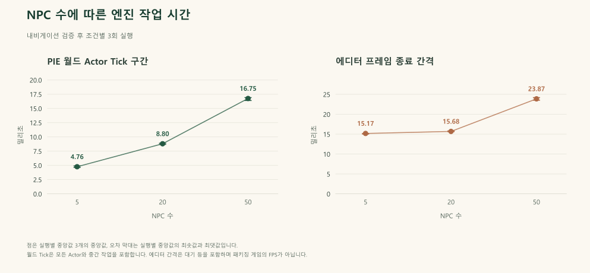

# 결과와 검증 근거

[English](results.md) | 한국어

아래 확정한 측정은 실제 엔진 검증의 확장과 대화 및 일정 규칙 수정에 대한 결과입니다. 원래 맵의 PIE와 실제 Blueprint 구현을 사용합니다. 동작 검증 건수와 조건부 이벤트 관측값이며, 머신러닝 정확도나 포트폴리오 가치의 추정 점수가 아닙니다.

## 검증 자료를 읽는 방법

PIE는 Unreal 에디터 안에서 게임을 실행하는 기능입니다. 별도로 규칙을
흉내 낸 프로그램이 아니라 실제 게임 객체와 함수를 대상으로 검사합니다.
상태 검증은 준비한 입력과 기대 동작의 관계를 확인하고, fixture는 그 입력
상태를 구성합니다. assertion은 개별 기대 항목의 확인이며, 검증 묶음인
suite와 실제 플레이 시나리오는 서로 다른 집계 단위입니다.

확률 측정은 반복 가능한 조건에서 실제 함수를 호출해 사건 발생 횟수를
셉니다. 시드는 난수 생성기의 시작 상태를 고정하는 값입니다. Wilson 구간은
유한한 관측 횟수에서 발생률을 추정할 때의 불확실성을 나타내며, 임의의
플레이에서 항상 같은 비율이 나온다는 보장은 아닙니다.

부하 측정의 Tick은 프레임마다 게임 객체를 갱신하는 처리입니다. 월드 Actor
처리 구간과 에디터 프레임 간격은 실행 과정의 서로 다른 부분을 측정합니다.
중앙값은 크기순으로 나열한 측정값의 가운데 값이며, 실행별 중앙값의 범위는
반복 실행 사이에서 대표값이 얼마나 달라졌는지 보여 줍니다. 시간이 작을수록
해당 조건의 측정 구간이 짧다는 뜻이며, NPC만의 계산 시간이나 모든 실행
환경의 프레임 속도를 보장하는 값은 아닙니다.

## 상태 규칙과 유지한 수정

| 같은 상태 검증 항목 | 통과 | 실패 | 전체 |
| --- | ---: | ---: | ---: |
| 초기 구현 | 69 | 9 | 78 |
| 수정 후 구현 | 78 | 0 | 78 |

같은 78개 상태 검증에서 이전에 실패한 기대 동작 9개를 충족했습니다. 8개는 새 퀘스트 확률이 일반 대화의 긴급 조건보다 먼저 실행되는 우선순위와 관련이 있습니다. 나머지 1개는 상호작용이 열려 있는 동안 귀가 의도를 발행하는 조건입니다. 특정 상황의 검증 항목 9개이며 서로 다른 AI 알고리즘 9개를 뜻하지 않습니다.

진행 중인 퀘스트가 없으면 수정한 Talk 경로는 스태미나 30 이하, 소지금 0을 먼저 확인한 뒤 기존 새 퀘스트 기회를 판단합니다. 진행 중인 퀘스트의 처리는 먼저 유지합니다. 활동 시간 밖의 일정은 `IsInteracting`이 참일 때 새로운 귀가 의도를 설정하지 않고, 상호작용을 닫으면 원래 경로를 재개합니다. 정확한 수정 범위는 [구조 문서](architecture.ko.md)에 설명합니다.

근거: [유효한 초기 상태 보고서](../reports/initial-state-contracts-valid.json), [수정 후 상태 보고서](../reports/corrected-state-contracts.json).

## 실제 대상 선택과 상호작용

미리 정한 Actor 방향 행렬의 **30개 조건 모두**에서 기대한 NPC를 선택했습니다. 원래 NPC 세 개의 위치를 고정하고 플레이어 Actor의 방향만 바꿉니다. 시험에서 표시 상태와 Actor 충돌을 준비하고 원래 플래그 및 위치를 복구하므로, 일정상 등장 조건과 방향 선택을 구분합니다. 각 조건에서 같은 세 NPC가 실제로 겹치는지 확인한 뒤 기존 `SendInteractionSignal`을 호출합니다. 각도 점수가 정확히 같은 경계는 제외하며, 정답은 게임의 선택 반복문과 별개로 미리 정합니다.

이는 구현한 Actor 전방 기준 선택 경로의 검증이며 카메라 기준 선택 측정은 아닙니다. 별도 조건에서는 NPC 겹침을 해제했을 때 이전 대상이 초기화되는지 확인합니다. 원래 인벤토리와 상점 화면이 만든 실제 UMG 버튼으로 구매, 묶음 판매와 음식 사용을 실행하고 소지금, 수량, 신뢰도와 스태미나를 직접 확인합니다. 이 과정의 개별 검증 항목 수와 완전한 플레이 상황 수는 구분해야 합니다.

근거: [수정 후 상호작용 보고서](../reports/corrected-interaction-contracts.json)의 `target_selection_matrix`와 거래 검증 항목.

## 실제 Blueprint에서 관측한 확률

| 실험 | 발생 수 | 호출 수 | 관측 비율 | Wilson 95% 구간 |
| --- | ---: | ---: | ---: | ---: |
| 희귀 아이템 선택 | 976 | 10,000 | 9.76% | 9.19% ~ 10.36% |
| 조건부 퀘스트 제안 | 1,003 | 10,000 | 10.03% | 9.46% ~ 10.63% |

두 실험은 엔진 난수 시드 378과 원래 임계값 0.1을 사용합니다. 아이템 실험은 `BP_Item_Master.DecideItem`을 호출하므로 실제 난수 비교, 데이터 행 조회, 메시와 재질 적용까지 실행합니다. 10,000회 모두 허용한 일반 또는 희귀 ID를 사용했고, 선택한 원래 Data Table 행과 일치했습니다. 비교식은 `random_draw <= 0.1`입니다.

퀘스트 실험은 실제 대화를 연 Charles의 Talk 경로를 호출합니다. 스태미나 100, 소지금 1,000, 진행 중 퀘스트 없음의 조건이며 호출마다 `InteractionEnd`를 초기화합니다. 집계한 값은 **조건을 갖춘 호출에서 발생한 퀘스트 제안**입니다. 물리적인 대화 입력 10,000회, 퀘스트 완료 10,000회나 보상 지급 횟수는 아닙니다. 완료와 보상에는 별도의 상태 규칙 검증을 사용합니다.

구간 추정은 해당 시험 조건에서 관측한 표본의 불확실성을 설명하며, 임의의 플레이에서 장기 발생률이 정확히 일정하다는 보장은 아닙니다. 별도 장식자는 `< Chance`를 사용합니다. 클래스 기본값, Behavior Tree 내부 인스턴스와 시험 인스턴스의 설정을 퀘스트 제안 실험과 혼동해서는 안 됩니다.

근거: [상호작용 보고서의 아이템 표본](../reports/corrected-interaction-contracts.json), [실제 퀘스트 제안 표본](../reports/corrected-quest-probability.json), [퀘스트 상태 규칙](../reports/corrected-quest-contracts.json).

원래 보고서의 100회 관측 실험은 당시 결과로 보존합니다. 새 엔진 측정 10,000회는 분모와 조건이 다른 별도 실험이며, 이전 기록을 조용히 대체하지 않습니다.

## 최적화 채택 판단

별도 후보에서는 Sequence의 순서와 매 프레임 동작을 유지하면서 Tick의 GameMode 조회와 캐스팅 세 쌍을 한 쌍으로 합쳤습니다. 같은 초기 소스의 NPC 50개 조건에서 실행별 중앙값 세 개의 중앙값은 12.97435ms에서 12.4509ms로 약 **4.03%** 감소했습니다. 사전에 정한 **5%** 채택 기준에 미치지 못해 채택하지 않았으며 원래 조회 구조로 복원했습니다.

이 비교의 월드 Actor Tick 구간은 모든 Actor와 중간 작업을 포함합니다. 활동 중인 NPC 수는 표시 상태, 충돌과 Blackboard 상태를 뜻하며 실제 유효 경로 이동의 근거는 아닙니다. 실험은 채택하지 않은 최적화 기록으로 보존하며 최종 배포본의 성능 개선으로 설명하지 않습니다. 내비게이션을 복원한 측정은 작업 부하가 다르므로 초기 시간과 비교해 FPS 개선이나 회귀를 주장하지 않습니다.

## 최종 내비게이션, 동행과 배포 검증

별도로 실행한 실제 엔진 내비게이션 검증은 **3개 단계 모두 통과**했으며 전체 실제 경과 시간은 **13.61초**입니다. 원래 맵, 원래 `BT_NPC`, 네이티브 경로 추종과 월드 Tick을 사용했습니다.

| 단계 | 실제 관측 | 결과 |
| --- | --- | --- |
| 순찰 | 최대 2D 변위 260.63uu, 작성한 귀가 좌표와 다른 목적지를 향하는 유효한 이동 경로, 원래 이동 설정 확인 | 통과 |
| 동행 | 플레이어와의 거리 800.00→511.90uu로 288.10uu 감소. NPC 최대 2D 변위는 293.17uu이며 플레이어 근처로 향하는 유효한 이동 경로 확인 | 통과 |
| 귀가 | 도달 가능한 가까운 귀가 시험 목적지로 최대 2D 변위 390.32uu 관측. 이후 네이티브 이동 성공, Actor 숨김과 충돌 비활성화 확인 | 통과 |

변위는 각 단계 시작 위치에서 떨어진 최대 거리이며 누적 이동 경로 길이가 아닙니다. 귀가 시험 목적지는 약 400uu 떨어진 도달 가능한 위치로, 원래 귀가 경로에 임시로 제공했습니다. 작성한 원래 귀가 좌표는 별도로 조회합니다. 이 시험의 통과가 모든 작성된 귀가 목적지의 도달 가능성을 의미하지는 않습니다. 근거는 [최종 내비게이션 보고서](../reports/final-navigation-contracts.json)입니다.

원래 `BT_NPC`의 추종 태스크 인스턴스는 클래스 기본값 300 대신 `ChaseSpeed=150`을 설정하고, 순찰 인스턴스도 150을 사용합니다. 게임 속도와 원래 트리 자산은 변경하지 않았습니다. 초기 속도 기대값이 클래스 기본값을 잘못 사용한 것이므로, 실제 작성한 태스크 인스턴스의 설정을 읽고 런타임 `NodeInstances`와 `CharacterMovement.MaxWalkSpeed`에 대조하도록 정정합니다. 이는 시험 정답의 수정이며 게임의 동행 속도를 고친 것이 아닙니다. 설정한 최대 속도는 실제 이동 속도가 항상 일정하다는 의미도 아닙니다.

실제 인벤토리 입력 검증도 **6개 항목 모두 통과**했으며 실제 경과 시간은 **64.37초**입니다. PlayerController에 E 누름과 해제를 전달해 새 묶음을 추가하고 기존 묶음의 수량을 늘렸습니다. 원래 Charles 거래 경로는 신뢰도 99에서 상품 3개, 100과 101에서 4개를 표시했습니다. 원래 아이템 Actor는 60초 지연 후 다시 표시되고 충돌이 활성화됐으며, 두 번째 획득 이후 관측한 간격은 게임 시간 60.005초입니다. 인벤토리 수량은 3개로 유지됐습니다. 근거는 [최종 인벤토리 입력 보고서](../reports/final-inventory-input-contracts.json)입니다. 실제 입력 처리와 위젯을 실행한 검증이며 물리적 키보드 포커스와 렌더링 배치는 별도 확인 범위입니다.

해시를 고정한 원본 압축 파일과 검증한 변경 번들로 새 프로젝트 폴더를 복원했습니다. 최종 소스 및 프로젝트 파일은 **2,371개**입니다. 변경 번들은 **29개 파일**로, 기존 파일 교체 7개와 새 에디터 플러그인 파일 22개로 구성됩니다. 재현에 사용하는 소스 식별 정보는 [최종 프로젝트 manifest](../manifests/final-project.json)에 기록합니다.

새 폴더의 소스 빌드는 컴파일러 빌드 **14.38.33145**와 Windows SDK **10.0.26100.0**에서 **빌드 작업 29개를 53.02초에 완료**했습니다. 이후 실행 도구는 별도로 **1.406초**의 최신 빌드 상태 확인을 통과했습니다. 실행 요약에 기록된 후자의 시간을 새 폴더의 전체 소스 빌드 시간으로 해석하지 않습니다.

새 폴더의 실행 도구는 소스 빌드 확인, Blueprint 검사와 실제 게임 검증 7개를 완료해 **실행 기록 9개 모두 통과**했습니다. Blueprint 검사는 `SkipSave`로 **프로젝트 Blueprint 46개를 컴파일해 오류와 경고가 모두 0**임을 확인했습니다.

| 실제 엔진 게임 검증 | 새 폴더 실행 결과 |
| --- | --- |
| 원래 월드 구성 | 원래 맵, 플레이어 조종 대상과 NPC 5개 확인 후 통과 |
| 상태 규칙 | 78개 중 78개 통과 |
| 상호작용 규칙 | 대상 선택 30조건을 포함한 검증 항목 273개 중 273개 통과 |
| 퀘스트 규칙 | 8개 중 8개 통과 |
| 조건부 퀘스트 제안 표본 | 실제 Talk 10,000회 호출 검증 통과 |
| 내비게이션 규칙 | 3개 단계 중 3개 통과 |
| 인벤토리 입력 규칙 | 6개 중 6개 통과 |

시험 묶음 7개와 각 묶음 안의 검증 항목은 집계 단위가 다르므로 하나의 큰 시험 수로 합산하지 않습니다. 근거는 [새 폴더 실행 요약](../reports/fresh-restoration/run.json), [Blueprint 검사](../reports/fresh-restoration/blueprints.json)와 같은 폴더의 시험별 JSON 보고서입니다. 앞서 제시한 별도 내비게이션 및 인벤토리 측정은 각각의 보고서와 경과 시간을 유지합니다.

별도로 **Windows에서 Python 도구 시험 44개가 통과**했습니다. WSL Linux에서는 **복원 도구 시험 18개와 메타데이터 시험 7개가 통과**했습니다. 파일과 압축 파일 처리, 메타데이터와 도구 동작의 검증입니다. Linux 도구 검증이 Linux Unreal 게임 실행을 의미하지는 않습니다. 실제 게임 실행은 **Windows와 Unreal Engine 5.4.4**에서 확인했습니다.

새 소스 복원과 빌드는 유지보수 PC에서 수행했으므로 새 폴더 재현의 근거이며 독립된 컴퓨터에서의 인증은 아닙니다. 확률 측정과 상태 검증은 명시한 시험 조건을 확인하며 가능한 모든 플레이 상황을 보장하지 않습니다. 실패한 실행과 잘못 구성한 시험은 유효한 초기 및 최종 결과와 구분해 보존합니다.

## 최종 부하 측정

내비게이션 검증 후 실제 NPC 인스턴스 5개, 20개, 50개를 각각 세 번 실행한 **최종 프로필 9개가 모두 통과**했습니다. 기록한 환경은 Unreal Engine 5.4.4, Intel Core i7-11800H, NVIDIA GeForce RTX 3060 Laptop GPU와 D3D12입니다. 모든 실행에서 실제 게임 뷰포트 1280 × 720, 준비 시간 10초와 수집 시간 15초를 확인했습니다.

아래 대표값은 실행별 중앙값 세 개의 중앙값입니다. 범위는 개별 프레임 표본의 범위가 아니라 실행별 중앙값의 최솟값부터 최댓값까지입니다.

| NPC 수 | 실행 수 | 월드 Actor Tick 중앙값 (ms) | 실행별 중앙값 범위 (ms) | 에디터 간격 중앙값 (ms) | 실행별 중앙값 범위 (ms) |
| ---: | ---: | ---: | ---: | ---: | ---: |
| 5 | 3 | 4.7614 | 4.6336 ~ 4.9032 | 15.1708 | 15.0291 ~ 15.1734 |
| 20 | 3 | 8.7988 | 8.6760 ~ 8.8901 | 15.6843 | 15.6178 ~ 15.8183 |
| 50 | 3 | 16.7516 | 16.3960 ~ 16.9055 | 23.8683 | 23.5253 ~ 24.1792 |

수집 조건은 같은 NPC 한 개 이상에서 25uu 초과의 2D 변위와 실제 이동 중인 유효 경로를 함께 관측하는 것입니다. 실제 관측 수는 NPC 5개 조건의 모든 실행에서 5개, 20개 조건에서는 15~18개, 50개 조건에서는 40~41개였습니다. 요청한 NPC 모두를 표본으로 기록했고, 종료 시 실제 AI 컨트롤러와 실행 중인 행동 트리의 수도 요청한 수와 일치했습니다. 원래의 대기 행동을 허용하면서 실제 이동이 있는 부하임을 확인한 근거이며 모든 NPC가 계속 걷거나 모든 목적지에 도착했다는 뜻은 아닙니다.

확장 조건은 원래 다섯 Actor를 유지하고 고정된 180uu 간격으로 복제 인스턴스를 추가합니다. 모든 복제 NPC를 내비게이션 위로 옮겨 놓지 않습니다. Actor별 위치, 변위, 경로와 내비게이션 관측은 원시 보고서에 남깁니다. 근거는 [최종 프로필 묶음과 원시 보고서 참조](../reports/final-profile-batch.json)입니다.

월드 Actor Tick 구간은 해당 PIE 월드의 Actor Tick 전후 이벤트 사이의 실제 경과 시간이며 모든 Actor와 중간 작업을 포함합니다. 에디터 간격은 네이티브 프레임 종료 콜백 사이의 경과 시간이며 에디터, PIE, 렌더링 대기와 관측 비용을 포함합니다. 이동 관측은 측정하는 Actor Tick 구간 밖에서 수행하지만 에디터 간격에는 비용이 반영됩니다. NPC만의 CPU 시간, GPU 프레임 시간이나 패키징한 단독 게임의 FPS가 아닙니다. 위 초기 소스의 최적화 비교와 내비게이션 복원 후의 부하는 구분합니다.

## 구현과 기록 보존 범위

실제 게임 AI는 작성한 규칙, Behavior Tree, Blackboard와 Data Table을 사용합니다. 원래 Qwen 적용 가능성 실험은 별도 작업이며 게임 제약을 일관되게 만족하지 못해 통합하지 않았습니다. 이 기록은 성공하지 못한 기술 검토로 보존하며 현재 NPC 대화를 구동하는 모델로 소개하지 않습니다.

원본 전체 압축 파일, 초기 핵심 자산, 초기 보고서, 보고서 PDF와 발표 자료를 보존합니다. 최종 변경 번들과 전후 manifest로 소스 변경을 검토할 수 있게 합니다. 검증은 게임 규칙을 Python으로 다시 작성하는 대신 실제 Blueprint와 엔진 상태를 사용합니다. [재현 가이드](reproduce.ko.md)에서는 도구 수준의 Windows 및 Linux 검사, Windows 게임 실행, 소스 빌드와 같은 컴퓨터에서 확인한 근거의 한계를 구분합니다.
