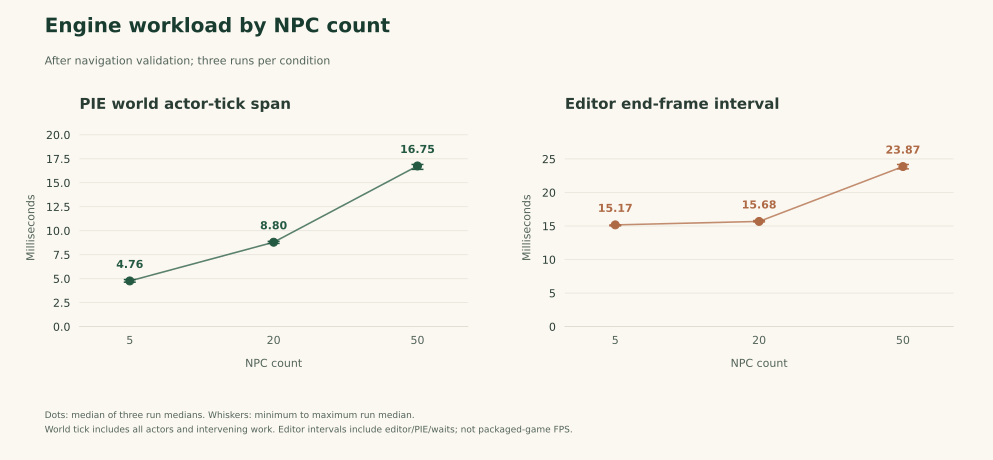

# Results and evidence

[English](results.md) | [한국어](results.ko.md)

The completed measurements below cover broader actual-engine verification and the reviewed dialogue and schedule corrections. They come from original-map PIE and actual Blueprint implementations. They are behavior counts and conditional event measurements, rather than machine-learning accuracy or an estimated portfolio-value score.

## Reading the evidence

PIE means Play in Editor: the game runs inside Unreal rather than in an external
reimplementation. A state contract specifies a prepared input state and an
expected response. A fixture creates that state, and an assertion checks an
individual expectation. A suite groups related checks, so suite counts, assertion
counts and whole gameplay scenarios use different denominators.

Probability measurements count events from actual functions under repeatable
conditions. A seed fixes the starting state of the random generator. Wilson
intervals express uncertainty from finite event counts, rather than a guarantee
that arbitrary play sessions will have exactly the measured frequency.

For workload measurements, a Tick is the update of game objects during a frame.
The world actor-tick span and editor frame interval measure different parts of
execution. Median means the middle sorted value; the run-median range shows how
that summary changed between repeated runs. Lower times describe shorter measured
intervals under those conditions, not isolated NPC computation or a universal
frame-rate guarantee.

## State contracts and retained corrections

| Same state-contract set | Passed | Failed | Total |
| --- | ---: | ---: | ---: |
| Initial implementation | 69 | 9 | 78 |
| Corrected implementation | 78 | 0 | 78 |

The retained correction satisfies nine previously failing expectations in the same 78-contract set. Eight concern a new-quest roll taking priority over critical ordinary dialogue. One concerns issuing a home intent while an interaction remains open. These are nine assertions within targeted scenarios, not nine different AI algorithms.

When no quest is active, the corrected Talk path checks stamina at or below 30, then money equal to zero, before evaluating the original new-quest opportunity. Active quest handling remains first. The corrected outside-hours schedule skips a new home intent while `IsInteracting` is true and resumes its original path after interaction closes. [Architecture](architecture.md) describes the precise retained scope.

Sources: [valid initial state report](../reports/initial-state-contracts-valid.json), [corrected state report](../reports/corrected-state-contracts.json).

## Actual target selection and interaction

The predefined actor-direction matrix selects the expected NPC in **30 of 30 conditions**. Three original NPC positions stay fixed while only the player Actor yaw changes. The fixture prepares visibility and actor collision locally and restores the prior flags and transforms afterward, keeping scheduled availability separate from direction selection. Every condition confirms the same three live overlaps before calling the original `SendInteractionSignal`. Exact angular ties are excluded and the expected answers are fixed independently of the production loop.

This verifies the implemented actor-forward selection path. It is not a camera-targeting measurement. Separate cases verify clearing a previous target after NPC overlaps disappear. Actual inventory and shop containers also exercise the original UMG buttons for purchases, stack sales and food use, with money, quantity, trust and stamina observed directly. Counts of individual assertions within those operations should remain distinct from counts of complete player scenarios.

Source: [corrected interaction report](../reports/corrected-interaction-contracts.json), including `target_selection_matrix` and the transaction checks.

## Probability in the actual Blueprint implementation

| Experiment | Observed events | Calls | Observed rate | Wilson 95% interval |
| --- | ---: | ---: | ---: | ---: |
| Rare item selection | 976 | 10,000 | 9.76% | 9.19% to 10.36% |
| Conditional quest proposal | 1,003 | 10,000 | 10.03% | 9.46% to 10.63% |

Both experiments use engine RNG seed 378 and the original 0.1 threshold. The item experiment invokes `BP_Item_Master.DecideItem`, including its actual random comparison, row lookup, mesh and material application. All 10,000 observed results use a permitted normal or rare ID and match the selected original Data Table row. Its comparison is `random_draw <= 0.1`.

The quest experiment invokes the actual Charles Talk path with the real dialogue open, stamina 100, money 1,000, no active quest, and `InteractionEnd` reset before each call. It counts **conditional quest proposals**. It does not represent 10,000 physical conversations, completed quests or reward payouts. Quest completion and rewards have separate state-contract tests.

The two intervals describe the observed sample uncertainty under these fixtures. They are not guarantees of an exact long-run frequency in arbitrary gameplay. The separate decorator uses `< Chance`; its class default, Behavior Tree instance value and test-instance configuration must not be conflated with the quest-proposal experiment.

Sources: [item sampling in the interaction report](../reports/corrected-interaction-contracts.json), [actual quest-proposal sampling](../reports/corrected-quest-probability.json), [quest state contracts](../reports/corrected-quest-contracts.json).

The original report's 100-observation experiments remain historical results. The new 10,000-call engine measurements have their own denominators and scopes and do not silently replace those records.

## Optimization decision

A candidate combined three GameMode lookup/cast pairs into one per Tick while retaining the Sequence order and per-frame behavior. In the same initial-source 50-NPC workload, the median of three run medians changed from 12.97435 ms to 12.4509 ms, a reduction of approximately **4.03%**. It did not reach the predefined **5%** adoption threshold, so the candidate was declined and the original lookup structure restored.

This screen measured the world actor-tick span, including all actors and intervening work. Its active NPC count described visibility, collision and Blackboard state, not proof of valid walking paths. The experiment is retained as a declined optimization, not presented as a final-release performance gain. Navigation-restored measurements use a different workload and must not be compared with those initial times as an FPS gain or regression.

## Final navigation, following and release checks

The dedicated actual-engine navigation suite passed **all three stages** in **13.61 real seconds**. It used the original map, original `BT_NPC`, native path following and world ticks.

| Stage | Actual observation | Result |
| --- | --- | --- |
| Patrol | Maximum 2D displacement 260.63 uu, an observed moving complete path away from the authored home, and the authored movement setting | Passed |
| Follow | Player gap decreased from 800.00 to 511.90 uu, a reduction of 288.10 uu; maximum NPC 2D displacement was 293.17 uu, with a moving complete path ending near the player | Passed |
| Home | Maximum 2D displacement 390.32 uu toward a reachable nearby home fixture, followed by native movement success, actor hiding and collision being disabled | Passed |

These are maximum displacements from each stage's starting position, not accumulated path lengths. The home fixture starts approximately 400 uu away and temporarily supplies a reachable destination to the original home path. The authored home coordinate is queried separately. Passing this fixture does not establish that every authored home destination is reachable. Evidence: [final navigation report](../reports/final-navigation-contracts.json).

The original authored `BT_NPC` chase-task instance overrides its class default of 300 with `ChaseSpeed=150`; the authored patrol instance is also 150. The game speed and original tree asset remain unchanged. The initial speed expectation incorrectly used the class default. The corrected oracle reads the actual authored task instance and compares its setting with runtime `NodeInstances` and `CharacterMovement.MaxWalkSpeed`. This is a test-oracle correction, not a gameplay follow-speed fix, and the configured maximum does not imply constant measured velocity.

The actual inventory-input suite also passed **6 of 6 cases** in **64.37 real seconds**. Real PlayerController E press/release input added a new item stack and incremented an existing stack. The original Charles trade path displayed three items at trust 99 and four at trust 100 and 101. The original item actors became visible and collision-enabled after the 60-second latent delay; the second pickup's observed interval was 60.005 game seconds, and inventory quantity remained three. Evidence: [final inventory-input report](../reports/final-inventory-input-contracts.json). These checks exercise the real input stack and widgets while keeping physical keyboard focus and rendered layout outside their scope.

A new project directory was restored from the hash-pinned original archive and the verified overlay. It contains **2,371 source/project files**. The overlay has **29 files**: seven replacements and 22 new editor-plugin files. [The final project manifest](../manifests/final-project.json) records the source identities used for reproduction.

The clean source build completed **29 build actions in 53.02 seconds**, using compiler build **14.38.33145** and Windows SDK **10.0.26100.0**. The subsequent runner performed a separate successful up-to-date build check in **1.406 seconds**. The latter is recorded in the runner summary and should not be mistaken for the cold-build duration.

The fresh-directory runner completed source-build verification, Blueprint inspection and all seven actual-engine gameplay suites. Its **nine execution records passed**. Blueprint inspection compiled **46 project Blueprints with zero errors and zero warnings**, using `SkipSave`.

| Actual-engine gameplay suite | Fresh-directory result |
| --- | --- |
| Original world inventory | Passed; original map, possessed player and five NPCs |
| State contracts | 78 of 78 passed |
| Interaction contracts | 273 of 273 checks passed, including the 30-condition target matrix |
| Quest contracts | 8 of 8 passed |
| Conditional quest-proposal sampling | Passed; 10,000 actual Talk calls |
| Navigation contracts | 3 of 3 stages passed |
| Inventory-input contracts | 6 of 6 passed |

The seven suites and their individual checks are different counting levels; they are not added into one inflated test total. Evidence: [fresh-restoration execution summary](../reports/fresh-restoration/run.json), [Blueprint inspection](../reports/fresh-restoration/blueprints.json) and the corresponding per-suite JSON reports in the same directory. The dedicated navigation and inventory measurements above retain their own report identities and timings.

Separately, **44 Python tool tests passed on Windows**. Under WSL Linux, **18 restoration-tool tests and seven metadata tests passed**. These cover file and archive handling, metadata and tool behavior. Linux tool validation does not establish Linux Unreal gameplay. The actual game runs recorded here used **Windows and Unreal Engine 5.4.4**.

The fresh source restoration and build were performed on the maintainer's PC, so they establish a new-directory reproduction rather than independent-machine certification. Probability measurements and state checks cover their declared fixtures, not every possible gameplay condition. Failed runs and invalid-fixture attempts remain labeled separately from the valid initial and retained results.

## Final workload measurements

All **nine final profile runs passed**: three runs each with 5, 20 and 50 actual NPC instances after navigation validation. The recorded environment was Unreal Engine 5.4.4, Intel Core i7-11800H, NVIDIA GeForce RTX 3060 Laptop GPU and D3D12. Every run recorded an actual 1280 × 720 game viewport, 10 seconds of warmup and 15 seconds of capture.

Each central value below is the median of the three run medians. The range is the smallest to largest run median, not the range of individual frame samples.

| NPCs | Runs | World actor-tick median (ms) | Run-median range (ms) | Editor interval median (ms) | Run-median range (ms) |
| ---: | ---: | ---: | ---: | ---: | ---: |
| 5 | 3 | 4.7614 | 4.6336 to 4.9032 | 15.1708 | 15.0291 to 15.1734 |
| 20 | 3 | 8.7988 | 8.6760 to 8.8901 | 15.6843 | 15.6178 to 15.8183 |
| 50 | 3 | 16.7516 | 16.3960 to 16.9055 | 23.8683 | 23.5253 to 24.1792 |

The capture gate requires at least one same NPC to show both more than 25 uu of 2D displacement and an actual moving complete path during the capture window. The observed counts were 5 of 5 NPCs in each five-NPC run, 15 to 18 of 20, and 40 to 41 of 50. Every requested NPC was sampled; final counts confirmed the requested number of actual AI controllers and running brains. These observations establish a live movement workload while allowing the original idle behavior. They do not imply continuous walking by every NPC or arrival at every destination.

The scaling fixtures preserve the original five actors and add clones at fixed 180 uu offsets. They do not silently relocate every clone onto navigation. Per-actor position, displacement, path and navigation observations remain in the raw reports. Source: [final profile batch and raw-report references](../reports/final-profile-batch.json).

World actor-tick spans are elapsed time between this PIE world's pre- and post-actor-tick delegates, including all actors and intervening work. Editor intervals are elapsed time between native end-frame callbacks and include editor, PIE, rendering waits and observation overhead. Movement probes execute outside the measured actor-tick span but contribute to editor intervals. These are not isolated NPC CPU time, GPU frame time or standalone packaged-game FPS. The navigation-restored workload is kept separate from the initial-source optimization screen above.

## Implementation and preservation scope

The deployed game AI uses authored rules, Behavior Tree, Blackboard and Data Tables. The original Qwen feasibility experiment was separate and was not integrated because it did not consistently meet gameplay constraints. It remains a documented unsuccessful exploration, not the model behind the retained NPC dialogue.

The original complete archive, initial core assets, initial reports, report PDF and presentation remain preserved. Final overlays and before/after manifests make source changes reviewable. Verification uses original Blueprint execution and actual engine state rather than a Python rewrite of the gameplay logic. [The reproduction guide](reproduce.md) distinguishes tool-level Windows/Linux checks, Windows game execution, source rebuilding and the limits of same-machine evidence.
